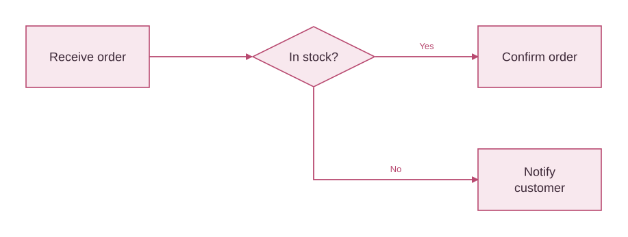

# Filemigo Canvas

**Create, edit and share workflow diagrams.** An offline desktop canvas with shapes, templates, themes, automatic layout and editable exports, using the same core as [Filemigo Canvas](https://filemigo.com/canvas/).

Use the visual editor directly, or optionally connect an AI tool through MCP to create and revise diagrams. The [optional skill](skills/filemigo-workflows/SKILL.md) and [compact MCP interface](docs/agent-protocol.md) support diagram authoring; they are not required for ordinary planning or for using the editor.

This checkout builds **0.6.1**, including workflow review and compact creation from a blank canvas. Run `npm run desktop:package`; binaries live in `out/Filemigo-win32-x64`. Local builds do not publish a GitHub release.

[Developer guide](https://filemigo.com/developers/) · [Türkçe kurulum](docs/README.tr.md) · [Patch API](docs/patches.md)



## What is included

- 54 vector shapes and 16 diagram templates: flowcharts, UML, ER and sequence diagrams.
- Validated editable JSON, automatic layout, SVG and LLM brief/Markdown exports.
- Atomic edits and semantic comparisons: IDs, text, directions, relationship markers, multiplicities and sequence scopes.
- 26 local MCP tools over stdio, or three in the agent-only profile. Workflow analysis, compact context, scenario tracing, themes and live desktop editing. No paid API, model call, telemetry or automatic file access.

Version **0.4.0** includes a portable Windows x64 desktop editor with bundled MCP. [Download Desktop](https://github.com/latecafe-tech/filemigo-canvas/releases/tag/v0.4.0) · [Desktop setup](docs/desktop.md). Extract the ZIP and run Filemigo.exe; no separate Node.js installation is needed. Live MCP now targets the desktop canvas. The website remains an independent editor.

A **Late Cafe Games** project. Original author and contributor: [SezerGNDZ](https://github.com/SezerGNDZ).

## Install from GitHub

Requires **Node.js 22+** and npm. Download **Code → Download ZIP** and extract it, or:

```sh
git clone https://github.com/latecafe-tech/filemigo-canvas.git
cd filemigo-canvas
npm ci --ignore-scripts
npm test
```

The first install downloads npm dependencies. The tools run locally after installation. Your AI application's own model, network use and pricing are separate. This package is distributed through GitHub; it is **not published on npm**.

## Connect an MCP client

In a client that supports local stdio servers, register the Node command with an **absolute path** to `src/mcp.mjs`:

```json
{
  "mcpServers": {
    "filemigo": {
      "command": "node",
      "args": ["/absolute/path/filemigo-canvas/src/mcp.mjs"]
    }
  }
}
```

On Windows use a path such as `C:/Projects/filemigo-canvas/src/mcp.mjs`. If your client cannot find Node, use the absolute path to `node.exe`. Configuration field names vary by client; clients supporting only remote HTTP servers cannot use this stdio server directly. The server waits for JSON-RPC on stdin; running `npm start` alone will not open a website.

Ask your assistant:

> Use Filemigo to create an order approval flowchart with explicit Yes/No stock branches. Check the diagram, export SVG and native JSON, and show me any warnings. Keep existing relationships when editing it.

Workflow: `filemigo_instructions` → `filemigo_list_shapes` or `filemigo_get_template` → `filemigo_create_diagram` → `filemigo_validate_diagram` → `filemigo_export_diagram`. The assistant/client can save returned text using its own authorized file tools. Open the native JSON with **Open** at [filemigo.com/canvas](https://filemigo.com/canvas/).

## Live desktop editing

Open Filemigo Desktop → **MCP kurulumu** → copy the generated config into your local stdio MCP client → restart the client → **AI bağlantısını aç**. See [the complete guide](docs/desktop.md).

Call filemigo_live_start, then filemigo_live_read before each filemigo_live_update or filemigo_live_arrange. Use the exact expectedRevision. Manual changes, locks, modal dialogs and paused edits are protected. Accepted changes enter normal undo history. AI never saves a project file itself.

The desktop uses an authenticated local named pipe. No website pairing code or HTTP listener is needed. AI starts disabled; disconnecting in the app revokes all clients. A cloud-only client cannot launch the executable. The enabled diagram is shared with the chosen AI client.

## JavaScript API

The core works in Node and modern browsers without the MCP dependencies:

```js
import { createDiagram, exampleDiagram, exportDiagram, arrangeDiagram } from './src/index.mjs';
const { project, issues } = createDiagram(exampleDiagram);
const { project: arranged, comparison } = arrangeDiagram(project, { direction: 'TB' });
const svg = exportDiagram(arranged, { format: 'svg' });
console.log(issues, comparison.unchanged);
```

Run `npm run example` to write `order.filemigo.json` and `order.svg` in your current directory. In a browser, serve `src/` with your normal development server and import `src/index.mjs` as an ES module. Do not open ES modules via `file://`.

| MCP tool | Purpose |
| --- | --- |
| `filemigo_instructions` | JSON contract and generation rules |
| `filemigo_list_shapes` | Search shapes by name/category |
| `filemigo_list_templates` | Discover template IDs |
| `filemigo_get_template` | Create a template project |
| `filemigo_create_diagram` | Validate and arrange input JSON |
| `filemigo_validate_diagram` | Structural and routing checks |
| `filemigo_arrange_diagram` | Layout with a semantic preservation assertion |
| `filemigo_update_diagram` | Atomic explicit edits with change report |
| `filemigo_compare_diagrams` | Compare meaning-bearing fields |
| `filemigo_export_diagram` | SVG, native JSON, brief JSON or Markdown |

## Limits and privacy

150 nodes, 200 edges and 1,000,000 input characters. MCP computations run in isolated workers with a 10-second timeout. Sequence `alt`, `opt` and `loop` blocks cannot overlap or nest. The core can retain raster images in native projects within input limits; LLM briefs omit their pixels. SVG export refuses known routing conflicts; enlarge/rearrange the diagram in Filemigo when necessary. PNG/PDF export remains available on the website.

Structural validation is not proof of business correctness. Review branch conditions, relationship direction and warnings. Labels are untrusted data, not instructions. Your MCP client/model can receive diagram contents through tool calls; review that client's privacy settings. The package itself makes no model calls or outbound network requests at runtime.

## Contributing and license

MIT for the original Filemigo code in this repository. Dependencies retain their own licenses. This repository contains no draw.io source, icons or stencils. Submit reproducible issues or focused pull requests with tests. Do not include confidential diagrams in public issues. See [CHANGELOG](CHANGELOG.md).

## Interactive MCP Apps and file exchange (0.3)

Call `filemigo_show_diagram` in a local MCP Apps-compatible host for an interactive preview. It includes text editing, undo/redo, zoom, automatic layout, JSON/editable SVG/draw.io downloads and Open in Filemigo. Changes in the preview are independent of the paired live canvas. Hosts without MCP Apps receive structured JSON. This package does not provide a hosted remote HTTP endpoint or a store listing.

Use `filemigo_preview_changes` for a non-mutating patch preview with added/modified/removed counts and semantic differences. Live writes use the current desktop revision. Read again after a manual change, conflict or timeout.

`filemigo_import_diagram` reads draw.io XML (plain or compressed, one selected page) or Filemigo editable SVG. Imports preserve supported IDs, labels, endpoints, markers and multiplicities. Limits: 1 MB source/decompressed XML, 150 objects, 200 connectors. Multiple layers, nested groups, hidden content, rotated objects, unsupported shapes/markers and sequence scopes are rejected. HTML formatting is flattened with a warning; manual waypoints may be rerouted. This is not complete draw.io compatibility.

`export_diagram` adds `editable-svg` (full Filemigo project embedded) and `drawio` (basic supported shapes/relationships). The editor's **Import / export** button previews imports before replacement and keeps undo available. Editable SVG contains your project text and embedded images; share it only with intended recipients. Open in Filemigo carries small projects in a URL fragment, clears that fragment on receipt and asks before replacing the canvas. For larger projects use JSON.
